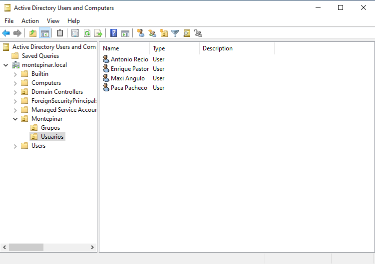
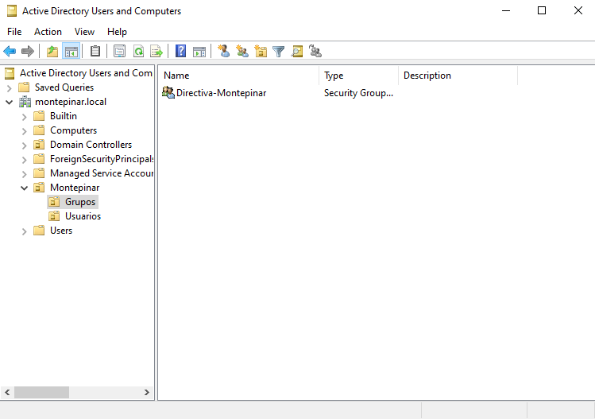
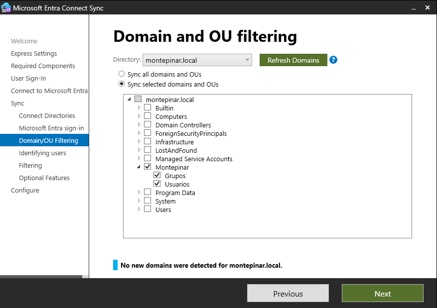
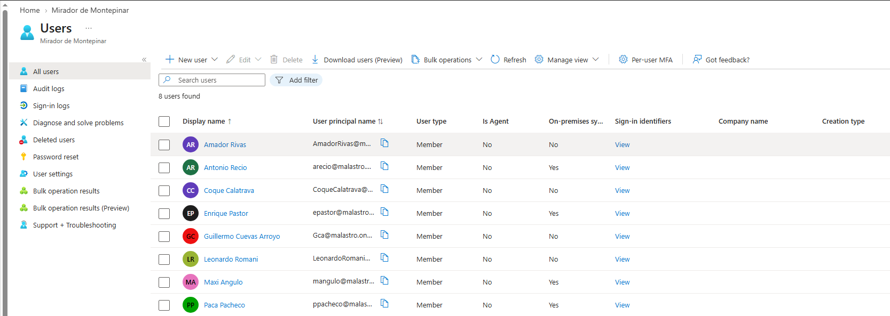
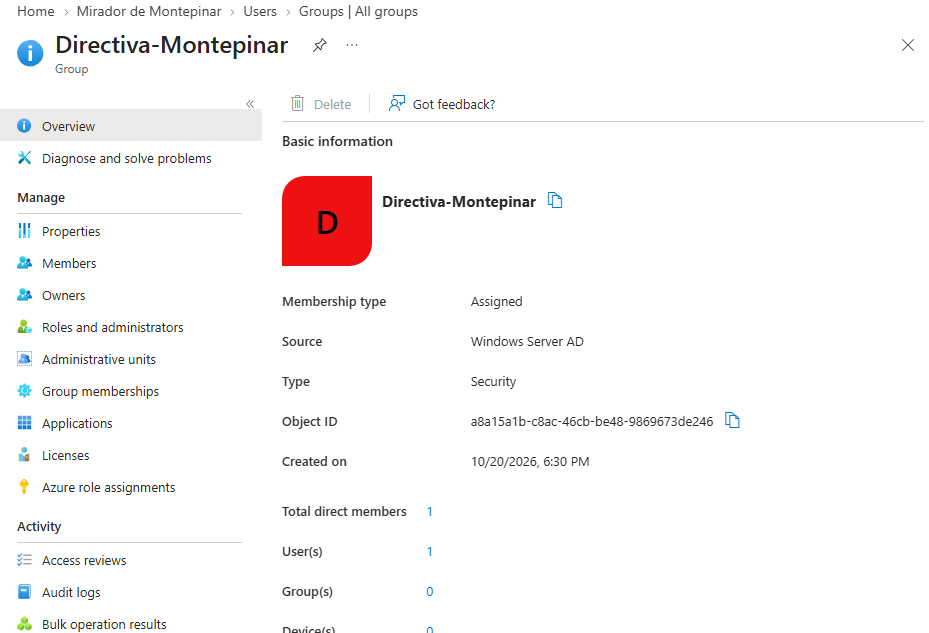

# Lab_01 Despliegue de Identidad Híbrida: Windows Server 2022 AD DS & Microsoft Entra ID

## 1. Descripción del proyecto

Laboratorio personal de identidad híbrida que integra Windows Server 2022 Active Directory Domain Services (AD DS) con Microsoft Entra ID mediante Microsoft Entra Connect Sync.

El objetivo es practicar la creación y organización de identidades en un dominio local, automatizar el aprovisionamiento básico de usuarios y grupos con PowerShell y comprobar su sincronización con el entorno cloud.

El laboratorio utiliza una organización ficticia, *Mirador de Montepinar SL*, inspirada en la serie *La que se avecina*. En este escenario, la empresa aborda la centralización de la gestión de identidades mediante un directorio local sincronizado con la nube.

El proyecto también documenta la configuración realizada, las decisiones técnicas y las comprobaciones efectuadas durante el despliegue.

## 2. Topología y componentes

| Entorno | Componente | Especificaciones | Rol / Función |
|---|---|---|---|
| On-premises | MONTEPINAR | Windows Server 2022 Datacenter | Controlador de dominio (`montepinar.local`) |
| On-premises | Script de PowerShell | Módulo ActiveDirectory | Creación de OUs, usuarios y grupos |
| Híbrido | Microsoft Entra Connect Sync | Versión instalada en el laboratorio | Sincronización de identidades entre el directorio local y la nube |
| Cloud | Microsoft Entra ID | Tenant de laboratorio (`malastro.onmicrosoft.com`) | Directorio de identidades en la nube |

## 3. Fases de implementación

### Fase 1. Estructura local de Active Directory y aprovisionamiento

Se creó una estructura de Unidades Organizativas (OUs) bajo OU=Montepinar, con las ramas OU=Usuarios y OU=Grupos.

Mediante PowerShell se crearon las cuentas de prueba y el grupo de seguridad Directiva-Montepinar.

Se configuró el atributo `userPrincipalName` de las cuentas utilizando el sufijo UPN elegido para el laboratorio, con el objetivo de facilitar su correspondencia con las identidades del entorno cloud.

**Evidencias:**
- Estructura de OUs en Active Directory.
- Grupo de seguridad local.
- Script de aprovisionamiento con PowerShell.




### Automatización con PowerShell

El siguiente script automatiza la creación inicial de usuarios y grupos en Active Directory.

📄 [Ver script de aprovisionamiento](./Script-Aprovisionamiento.ps1)


### Fase 2. Configuración de Microsoft Entra Connect Sync

Se configuró Microsoft Entra Connect Sync para sincronizar identidades desde Active Directory Domain Services hacia Microsoft Entra ID.

Se seleccionó Password Hash Synchronization (PHS) como método de autenticación híbrida y se configuró el filtrado por OU para limitar el ámbito de sincronización a `OU=Montepinar`.

También se revisó la configuración del atributo de origen (*sourceAnchor*), utilizado para mantener la correspondencia entre los objetos del directorio local y sus identidades sincronizadas en la nube.

**Objetivo de seguridad:** limitar los objetos incluidos en la sincronización y reducir el riesgo de incorporar accidentalmente al entorno cloud cuentas que estén fuera del ámbito definido.

**Evidencia:**
- Configuración del filtrado por OU en Microsoft Entra Connect.



### Fase 3. Verificación de la sincronización en Microsoft Entra ID

Tras ejecutar la sincronización inicial, se comprobó en el portal de Microsoft Entra ID la aparición de las cuentas de usuario y del grupo de seguridad creados en Active Directory.

Las verificaciones realizadas permitieron comprobar:

- La presencia de los usuarios en el directorio cloud.
- El estado de sincronización indicado en sus propiedades.
- La presencia del grupo de seguridad y la información disponible sobre su origen.

**Evidencias:**
- Usuarios sincronizados en Microsoft Entra ID.
- Grupo de seguridad sincronizado en Microsoft Entra ID.




## 4. Consideraciones de seguridad y limitaciones

Este laboratorio se ha desarrollado con fines educativos y no constituye una arquitectura de producción.

Durante el diseño se han tenido en cuenta los siguientes principios:

- **Alcance de la sincronización:** limitar los objetos incluidos mediante filtrado por OU.
- **Protección de cuentas privilegiadas:** evitar que las cuentas administrativas se incorporen a la sincronización sin una necesidad justificada.
- **Administración segura:** utilizar cuentas administrativas diferenciadas y estaciones de trabajo de acceso privilegiado (PAW) en entornos productivos.
- **Protección de credenciales:** evitar contraseñas incrustadas en scripts y documentar las políticas de contraseña aplicadas a las cuentas de prueba.

Las recomendaciones sobre PAW, restricciones de navegación en controladores de dominio y protección de sesiones administrativas se consideran medidas de referencia para un entorno productivo. No se presentan como controles implementados si no se han configurado y verificado en este laboratorio.

## 5. Validación mediante PowerShell

Se utilizaron los siguientes comandos en el servidor donde está instalado Microsoft Entra Connect Sync para consultar el programador de sincronización e iniciar una sincronización diferencial.

```powershell
# Consultar la configuración del programador de sincronización
Get-ADSyncScheduler

# Iniciar una sincronización diferencial
Start-ADSyncSyncCycle -PolicyType Delta
```

`Get-ADSyncScheduler` permite consultar la configuración del programador de sincronización.

`Start-ADSyncSyncCycle -PolicyType Delta` inicia un ciclo de sincronización diferencial. La ejecución del comando no garantiza por sí sola que todos los objetos se hayan sincronizado correctamente; el resultado debe comprobarse en el directorio de destino.

## 6. Posibles mejoras futuras

- Mejorar el script de aprovisionamiento con validaciones y comprobaciones de errores.
- Verificar el comportamiento del script cuando los usuarios o grupos ya existen.
- Documentar el ciclo de vida de las identidades: alta, modificación y baja (*Joiner, Mover, Leaver*).
- Ampliar las pruebas de gestión de grupos y permisos.
- Explorar la integración de la gestión de identidades híbridas con conceptos de Privileged Access Management (PAM).
